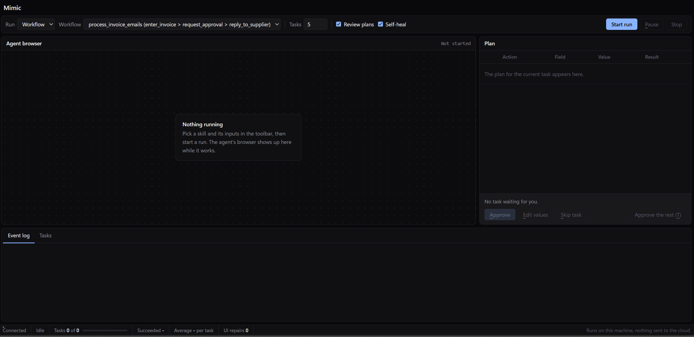
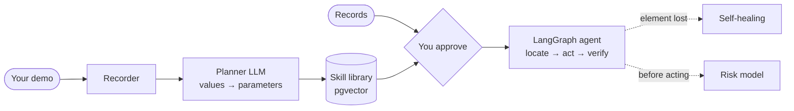
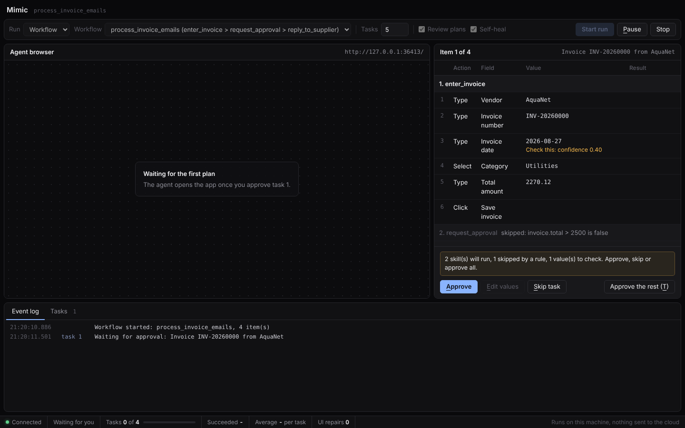

<div align="center">

# Mimic

### Show it once. It does it forever.

**A local AI agent that learns a repetitive web task from a single demonstration,<br/>
repairs itself when the interface changes, and asks you before it acts.**

[](https://pypi.org/project/mimic-agent/)
[](https://github.com/SamyBaouche/mimic/actions/workflows/ci.yml)
[](https://huggingface.co/SamyBaouche/mimic-element-matcher)
[](#quickstart)
[](#how-it-works)
[](#quickstart)
[](#how-it-works)
[](#predicting-failures)
[](#experiments-and-model-versions-mlflow)
[](https://github.com/SamyBaouche/mimic/blob/main/LICENSE)



[Results](#results) · [How it works](#how-it-works) · [Quickstart](#quickstart) · [Roadmap](#roadmap)

</div>

---

## What it does

<table>
<tr>
<td width="25%" align="center"><b>Learns from one demo</b><br/><sub>Do the task once. Mimic records every field, value and click.</sub></td>
<td width="25%" align="center"><b>Replays at scale</b><br/><sub>Runs the same task on 50, 500, 5 000 records.</sub></td>
<td width="25%" align="center"><b>Heals itself</b><br/><sub>Button renamed or moved? It finds it again and remembers.</sub></td>
<td width="25%" align="center"><b>Asks first</b><br/><sub>Shows its plan. Nothing happens without your approval.</sub></td>
</tr>
</table>

> **Everything runs on your machine.** Screens and form data never leave it.

## Results

<sub>Local models on a consumer PC · every result checked against what the app really saved</sub>

| | Without Mimic's safeguards | With Mimic |
|:--|:--:|:--:|
| Replay of a learned task (sandbox, 50 invoices) | — | **100%** success (50/50) |
| **Real app it was not built for** (stock Django admin, 30 rows from Excel) | — | **30/30** saved correctly, **0.44 s** per row |
| After a UI redesign | **0%** | **100%** |
| Cost of a repair | — | **8.4 s** with vision → **7.7 ms** with the fine-tuned matcher |
| **Cross-app workflow** (5 supplier emails: invoice PDF → ledger → approval above 2 500 $ → reply), 7B | — | **5/5** emails done in 3 apps, approved from the dashboard |
| Reading invoice PDFs (50 docs, 3 layouts), 7B models | 76% of fields right | **99.2%** of fields right, **100%** of errors flagged |
| Same with the light 3B models (laptops without a GPU) | 6% of documents right | **98.4%** of fields right, **100%** of errors flagged |
| **Real scanned receipts** (ICDAR 2019 SROIE, 50 receipts, 7B) | 95.3% of fields right | **97.3%** of fields right (store, date, total) |
| Flaky pages (cookie banners, slow buttons, errors), 50 tasks | 29 failed actions, 42% of tasks done | **5** failed actions (**−83%**), **90%** of tasks done |
| Speed vs. always fixing the page | 3.2 s / task | **1.3 s** / task (**58% faster**), fixing 11% as many steps |

## How it works



| Step | What happens |
|:--|:--|
| **1. Record** | You do the task once; each field, value, label, position and screenshot is captured. |
| **2. Learn** | A local LLM turns typed values into parameters (`Vendor ← {vendor}`) and stores the skill in pgvector. |
| **3. Review** | You see exactly what will be typed and clicked: approve, edit, skip or approve all. |
| **4. Replay** | A LangGraph loop finds each element, acts, and checks the result really happened. |
| **5. Heal** | If an element is lost: reuse a past fix → match by meaning → ask a vision model. |
| **6. Predict** | Before risky actions, an XGBoost model decides if the page needs fixing first. |

### Self-healing, step by step

When the redesign renames **Save invoice** to **Record** and moves it next to two decoy buttons:

1. **Memory**: was this step already repaired on this page? Reuse the fix instantly.
2. **Matcher**: a small Hugging Face cross-encoder (MiniLM, 22M parameters) fine-tuned on
   synthetic redesigns scores every candidate in milliseconds on a CPU.
3. **Meaning**: compare the old button with every candidate using embeddings.
4. **Vision**: only if the matcher is unsure, Qwen2.5-VL sees the demo with the old button **boxed in red**, and the new
   screen with **numbered boxes**. It answers a number, never a guessed coordinate.

> **Vision proposes, the DOM verifies.** A repair is remembered only after the action worked:
> a submit must navigate, an error page counts as a failure. A wrong guess never spreads.

### Predicting failures

Real pages are flaky. Before each action Mimic checks the element (covered? disabled? on screen?
found how, with what confidence?) and an **XGBoost** model predicts the chance of failure.
Fixing the page costs time, so Mimic only does it when the risk is high: **33 of the 300 steps**
that fixing everything would touch. The trade-off, measured on the same 50 flaky tasks: fixing
every step succeeds a little more often (96% vs 90%) but is 2.4× slower (3.2 s vs 1.3 s per task).

<details>
<summary><b>How the model was evaluated (click to expand)</b></summary>
<br/>

- **No leakage:** train/test split by run, so steps of one run never appear on both sides.
- **Cost-aware threshold:** tuned on training data with F2. A missed failure costs a whole
  task; an unnecessary fix costs ~0.4 s.
- **Fair A/B test:** the three policies (never / always / predicted) replay the exact same
  seeded perturbations.
- **Honest baselines:** compared with logistic regression and hand-written rules on every
  training. On today's data (1 938 steps from 12 runs, 8.6% failures) XGBoost and logistic
  regression rank risk equally well (PR AUC 0.70 vs 0.71); logistic regression has the better F1,
  and the rule "click on a blocked element" the best F1 but a much weaker ranking (PR AUC 0.37).
  XGBoost stays the default because it learns feature interactions without hand-coding them;
  every training and A/B test is tracked in MLflow, so changing that is a measured decision.

| Model (test set: 390 steps) | ROC AUC | PR AUC | F1 |
|:--|:--:|:--:|:--:|
| XGBoost | 0.97 | 0.70 | 0.47 |
| Logistic regression | 0.97 | 0.71 | 0.54 |
| Rule: click on a blocked element | 0.71 | 0.37 | 0.55 |
| Rule: covered or disabled | 0.65 | 0.12 | 0.27 |
| Always predict failure | 0.50 | 0.07 | 0.12 |

</details>

### Reading documents

Point Mimic at a folder of invoices (PDF or photos) instead of a spreadsheet. The skill knows
which values it needs, so Qwen2.5-VL is asked for exactly those, with a confidence per field.
Values are normalised (`22/02/2026` → `2026-02-22`, `3 389,96 $` → `3389.96`, `software` →
`Software`), and anything uncertain is flagged in the plan for you to check.

```bash
mimic sandbox                                       # also writes 50 invoice PDFs, 3 layouts
mimic extract eval                                  # field-level accuracy vs ground truth
mimic run enter_invoice --docs sandbox/data/documents --limit 5
```

### Real receipts, not just generated PDFs

`mimic extract receipts --n 50` downloads real scanned shop receipts (ICDAR 2019 SROIE) and
scores the store name, the date and the total paid. Faded print, handwriting, no text layer.

- **97.3%** of fields right, 92% of receipts fully right, 8.6 s per receipt (7B models).
- The 4 remaining mismatches were checked by hand: 2 typos in the dataset's own answers, 1
  receipt that names both a shop and its owning company, 1 where the dataset expects the total
  before tax and Mimic read the total paid.
- Scans have no text layer to check a reading against, so Mimic reads them twice and flags
  disagreements. This is weaker than on digital PDFs: it sends 20% of fields to review and
  caught 1 of the 4 mismatches. `DOUBLE_CHECK_SCANS=false` halves the time.
- Real receipts also showed 163 of 626 dates in formats Mimic could not read (12-01-19,
  28 MAR 18, 20180304). All 626 now parse.

### Real apps, not just the sandbox

The sandbox was built to be hard in known ways; a real app is hard in unknown ones. So Mimic is
also tested on a **stock Django admin**, the kind of internal tool many companies run, with
markup Mimic was not designed around (labels without `for`, `<fieldset>` legends, buttons
written as `<input value="Save">`, dropdowns whose label differs from their value).

- **Every common action:** text, dates, numbers, dropdowns, radio buttons, checkboxes, file
  uploads, Enter in a search box, and flows over several pages.
- **Knows when it worked:** at the end of the demo Mimic remembers the page and the
  confirmation message ("The expense “Taxi” was added successfully."). On every replay it
  checks for the same kind of message, with the ids and values of that task.
- **Skips what the app skips:** signed in after the first task? The sign-in steps are skipped.
- **Your data as it is:** an Excel or CSV file with your own column names (`Date`, `Montant`);
  each row comes back with `done` / `failed` and the reason, and `--only-failed` retries the rest.

```bash
uv run python scripts/realapp_benchmark.py --rows 30   # starts the admin, records, replays, checks the DB
```

### Work that crosses apps: workflows

Real office work rarely stays in one app. A **workflow** chains skills that were each learned
from one demo in their own app, for every email (or every row of a spreadsheet):

```yaml
for_each:
  emails: sandbox/data/mail              # .eml files, as Outlook / Gmail export them
steps:
  - read: attachment                     # the invoice PDF, read for what enter_invoice needs
    fields_of: enter_invoice
    as: invoice
  - run: enter_invoice                   # ledger app
  - run: request_approval                # approvals app
    if: the total is over 2 500 $        # plain words, shown to you as: invoice.total > 2500
    with: { reference: "{invoice.invoice_number}", amount: "{invoice.total}" }
  - run: reply_to_supplier               # mail app
    url: /mail/{email.id}/reply
    with: { message: "We received invoice {invoice.invoice_number}." }
```

- **Conditions in plain words**, translated once by the local LLM into a rule that is checked
  (known fields only, no code) and shown before anything runs. Or write the rule yourself.
- **One plan per email** to approve: what was read (uncertain values flagged), which steps run,
  which are skipped and why, which values come from the demo.
- **Every step is verified** with the confirmation its own demo ended on; if one fails, that
  email stops there and the next one starts.
- The sandbox's WorkSuite (`/mail`, `/approvals/new`, the ledger) runs this end to end in the
  tests: 6 emails, the rule sends only the large invoices for approval, and each app is checked
  for what it really received. Document reading is measured separately (99.2% of fields).

Each skill is learned once, in its own app (with `mimic sandbox` running):

```bash
mimic record enter_invoice --url http://localhost:8001                          # fill an invoice, Save
mimic record request_approval --url http://localhost:8001/approvals/new        # pick an approver, Request
mimic record reply_to_supplier --url http://localhost:8001/mail/mail-0001/reply # type a message, Send
mimic learn recordings/enter_invoice/recording.json     # and the same for the two others
```

```bash
mimic workflow check examples/process_invoice_emails.yml
mimic workflow run examples/process_invoice_emails.yml --limit 3
mimic serve          # or pick the workflow in the dashboard (Run: Workflow)
```

In the dashboard, each email's plan is shown skill by skill: the values read from the
attachment (uncertain ones flagged), the skills a rule skips and why. Approve, skip or approve
the rest, then watch every skill run in the agent browser.



### Distilling vision into a small model

The 7B vision model repairs well but needs seconds and a GPU. The **element matcher** is a
MiniLM cross-encoder fine-tuned on thousands of synthetic redesigns ("Save invoice" vs
"Submit bill" vs decoys like "Export CSV"), built from banks of real-world synonyms.

- Every label used by the LedgerLite v2 redesign is **held out of training**, so the sandbox
  test measures generalisation, not memorisation.
- Compared with string similarity and with the same model before fine-tuning.
- If its best candidate is not clearly ahead, the vision model still decides.

The trained model is published on the Hugging Face Hub
([SamyBaouche/mimic-element-matcher](https://huggingface.co/SamyBaouche/mimic-element-matcher),
with its model card and measured results) and downloaded once on first use. To retrain it:

```bash
pip install "mimic-agent[matcher]"
mimic matcher train     # downloads MiniLM once, fine-tunes, evaluates
mimic matcher push --repo your-name/mimic-element-matcher   # optional: publish yours
```

<details>
<summary><b>Design decisions (click to expand)</b></summary>
<br/>

- **Numbered boxes instead of coordinates.** A 7B vision model was unreliable at pixel
  coordinates but robust at picking a number, and a number always maps to a real element.
- **Forced choice + confidence gating.** On a submit button a wrong pick is caught by the
  navigation check, so a best guess is safe. On a text field it would go unnoticed, so the
  model must be at least 60% confident.
- **Give up after 3 failed repairs** on the same step, so a broken page does not keep
  paying for model calls.
- **Mapping by meaning.** The data says `total`, the skill says `total_amount`, the screen
  says `Total amount`: all three are understood, by you and by the agent.

</details>

### Experiments and model versions (MLflow)

Every training run and every benchmark is tracked with **MLflow**: parameters, metrics and
files, next to your skills (`~/.mimic/mlflow.db`) or on your own MLflow server
(`MLFLOW_TRACKING_URI`). Each trained model becomes a new **registered version**; Mimic
loads the one behind the `production` alias, so a retrained model is compared first and used
only once you promote it.

```bash
pip install "mimic-agent[mlflow]"
mimic risk train                 # tracked, registered as mimic-risk-model v2
mimic risk evaluate              # A/B test of the new version, tracked too
mimic models                     # versions side by side, which one is in production
mimic models promote risk 2      # Mimic uses v2 from the next run
mimic models ui                  # browse every run in the MLflow UI
```

| Experiment | What is logged |
|:--|:--|
| `mimic-risk` | XGBoost and its baselines (ROC AUC, PR AUC, precision, recall, F1), the A/B test |
| `mimic-matcher` | Fine-tuning settings, loss, top-1 accuracy before / after, on held-out labels |
| `mimic-extraction` | Document and receipt benchmarks per vision model and profile, every mistake |

The first version of a model goes to production by itself; without MLflow (or with
`MIMIC_TRACKING=off`) nothing is logged and the models in `./models` are used as before.

## Quickstart

**You need:** Python 3.11+ and [Ollama](https://ollama.com). No database to install.

```bash
pip install mimic-agent
playwright install chromium
mimic doctor --pull   # picks the models for your machine, downloads them, checks everything else
```

Mimic picks its local models from your hardware: **7B models** with a GPU or 16 GB+ of RAM,
**3B models** ("light") on smaller laptops. Force one with `MIMIC_PROFILE=standard` or
`MIMIC_PROFILE=light`.

Try it on the demo app (a small accounts-payable tool) in a second terminal:

```bash
mimic sandbox       # http://localhost:8001, plus 50 demo invoices and PDFs in ./sandbox/data
```

Then **teach, learn, run**:

```bash
mimic record enter_invoice --url http://localhost:8001   # do the task once in the browser
mimic learn recordings/enter_invoice/recording.json     # turn it into a skill
mimic run enter_invoice --limit 5 --show                 # watch it repeat the task
mimic run enter_invoice --layout v2                      # survive a redesign
mimic serve                                              # or drive it from the live dashboard
```

**Passwords are never recorded.** If a demo types into a password-like field, the value stays in
the browser and the skill gets a secret parameter. Give it for the session:
`MIMIC_SECRET_PASSWORD=...` (PowerShell: `$env:MIMIC_SECRET_PASSWORD="..."`).

<details>
<summary><b>Install from source, optional extras (click to expand)</b></summary>
<br/>

```bash
git clone https://github.com/SamyBaouche/mimic.git && cd mimic
uv sync && uv run playwright install chromium
uv run mimic doctor
uv run pytest
```

| Extra | Adds |
|:--|:--|
| `mimic-agent[ml]` | XGBoost failure-risk model (`mimic risk ...`, `--risk-policy predicted`). On macOS: `brew install libomp` |
| `mimic-agent[matcher]` | Fine-tuned Hugging Face element matcher (`mimic matcher train`) |
| `mimic-agent[postgres]` | Postgres + pgvector storage (`DATABASE_URL=postgresql://...`, `docker compose up -d`) |
| `mimic-agent[all]` | Everything above |

</details>

<details>
<summary><b>All commands (click to expand)</b></summary>
<br/>

| Command | What it does |
|:--|:--|
| `mimic doctor [--pull]` | Check hardware, browser, local models, storage; `--pull` downloads missing models |
| `mimic sandbox [--port 8001]` | Start the demo app and write demo invoices and PDFs |
| `mimic record NAME --url URL` | Record one demonstration |
| `mimic learn PATH` | Turn a recording into a reusable skill |
| `mimic skills` · `show N` · `search "TEXT"` · `delete N` | Manage the skill library |
| `mimic skills edit N` | Change a skill without recording it again: `--fix input=value`, `--remove STEP`, `--input STEP=name`, `--rename old=new` (or interactive) |
| `mimic skills export N` · `import FILE` | Share a skill as a .json file; undo an edit from its automatic backup |
| `mimic run N --data FILE.xlsx` | Replay on every row of an Excel / CSV / JSON file, with plan review |
| `--only-failed` · `--results out.xlsx` | Retry only the rows not done · choose where results go |
| `--yes` | Skip the review (trusted skills only) |
| `--confirm-submit --show` | Fill the form, then ask before pressing submit |
| `--layout v2` · `--no-heal` · `--debug` | Redesigned UI · baseline · show healing decisions |
| `--chaos 0.4 --risk-policy predicted` | Flaky pages, fix only the risky steps |
| `--docs FOLDER` | Read the inputs from PDFs / photos instead of a data file |
| `mimic workflow check` · `run FILE.yml` | Chain skills across apps for every email / row, with conditions |
| `mimic serve [--port 8765]` | Live dashboard: run a skill or a workflow, approve from the browser |
| `mimic read FILE` · `mimic extract eval` | Extract one document · measure extraction accuracy |
| `mimic extract receipts --n 50` | Benchmark on real scanned receipts (ICDAR 2019 SROIE) |
| `mimic risk collect` · `train` · `evaluate` | Telemetry, XGBoost, A/B test |
| `mimic matcher train` · `evaluate` · `push` | Fine-tune, measure, publish the Hugging Face element matcher |
| `mimic models` · `promote KIND N` · `ui` | Tracked versions (MLflow), the one in production, the UI |

</details>

<details>
<summary><b>The sandbox: LedgerLite (click to expand)</b></summary>
<br/>

A small accounts-payable app used to train and grade the agent.

| URL | What you get |
|:--|:--|
| `/?layout=v1` | Original interface |
| `/?layout=v2` | Redesign: fields reordered, button renamed and moved, decoy buttons, new ids |
| `/?chaos=0.4&seed=1` | Reproducible flakiness: cookie banner, slow buttons, renamed labels, HTTP 500 |
| `/login` | Sign-in page (user `demo`, password `ledger-demo-2026`) to try secret fields |
| `/mail` · `/approvals/new` · `/expenses/new` | WorkSuite: supplier emails with PDFs, approvals, 2-page expense reports |
| `/api/entries` | What was really recorded, used to grade the agent |

</details>

## Built with

| Layer | Tools |
|:--|:--|
| Agent | LangGraph · Playwright |
| Models (local) | Ollama · Qwen2.5 · Qwen2.5-VL · nomic-embed-text |
| Fine-tuning | Hugging Face Transformers · PyTorch · MiniLM cross-encoder |
| Memory & data | SQLite (default) · PostgreSQL + pgvector |
| Machine learning | XGBoost · scikit-learn · MLflow (tracking, model registry) |
| Dashboard & CLI | FastAPI · WebSocket · Chrome DevTools Protocol screencast · `mimic` CLI |
| Quality | pytest (233 tests on Linux, Windows, macOS) · Ruff · GitHub Actions |

## Roadmap

- [x] Learn from one demonstration · replay · plan review
- [x] Self-healing with memory, embeddings and vision
- [x] XGBoost failure risk model with fair A/B evaluation
- [x] Fine-tuned Hugging Face element matcher (vision only when unsure)
- [x] Read inputs from documents (PDF, photos) with per-field confidence
- [x] Live dashboard: streamed agent browser, approve / edit / skip / pause from the page
- [x] `pip install mimic-agent`, a `mimic` CLI, `mimic doctor`, SQLite by default
- [x] Passwords never recorded: secret fields become run-time parameters
- [x] Checkboxes, radio buttons, Enter, uploads, multi-page flows; tested on a real Django admin
- [x] Success learned from the demo's confirmation; Excel / CSV in, results file out
- [x] WorkSuite: mailbox + approvals apps, workflows across apps with plain-words conditions
- [x] Workflows in the dashboard: start one, approve each email's plan, watch every skill run
- [x] MLflow: every training and benchmark tracked, models versioned, `production` alias loaded
- [x] v1.0: one install, every result above measured and reproducible
- [ ] Learn from a screen-recording video
- [ ] Browser extension to record in one click

## Limitations

- **Web apps only** for now, learned from **live demonstrations** (not videos yet).
- A skill **repeats one path**. Decisions ("if the amount is over 5 000 $, send for approval")
  are written in a workflow, in plain words or as a rule; they are not guessed from demos.
- A field you **leave at its default** during the demo is not learned: change it once if
  other tasks need another value.
- **Captchas and two-factor codes** are not bypassed, by design: Mimic stops and asks you.
- Measured on a sandbox and on a stock Django admin. Every new app will bring new surprises:
  that is exactly where [contributions](https://github.com/SamyBaouche/mimic/blob/main/CONTRIBUTING.md) help most.

---

<div align="center">

**Found a task Mimic should handle?** [Open an issue](https://github.com/SamyBaouche/mimic/issues/new/choose) · [Contribute](https://github.com/SamyBaouche/mimic/blob/main/CONTRIBUTING.md)

MIT © 2026 [Samy Baouche](https://www.linkedin.com/in/samybaouche)

</div>
