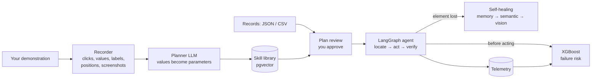

# Mimic

**Show it once. It does it forever.**

Mimic is a local AI agent that learns a repetitive web task from a **single screen
demonstration**, replays it on hundreds of records, **repairs itself** when the interface
changes, and **asks you before acting**. Everything runs on your machine.

<!-- Replace with your recording: docs/demo.gif -->


---

## Why

Every company has people copying data from one screen to another: invoices into accounting,
leads into a CRM, requests into a ticketing tool. Classic automation (RPA) breaks as soon as a
button moves. General AI agents improvise from a text prompt and are hard to trust.

Mimic sits in between:

| | Classic RPA | Prompt-driven AI agents | **Mimic** |
|---|---|---|---|
| Learns from | hand-written scripts | a text instruction | **one demonstration** |
| UI changes | breaks | improvises | **self-heals, verifies, remembers** |
| Human control | none | varies | **plan review before acting** |
| Data leaves your machine | no | usually yes | **no (local models)** |

## Results

Measured on the LedgerLite sandbox (50 invoices per run), local models on a consumer PC.

| What | Result |
|---|---|
| Replay of a learned skill, original UI | **100% task success** (50/50) |
| After a UI redesign (renamed + moved button, decoy buttons) | **0% → 100%** with self-healing |
| Cost of healing | first fix by vision **8.4 s**, then reused from memory in **0.3 s** |
| Flaky pages (cookie banners, disabled buttons, HTTP 500) | **−76% failed actions** with the XGBoost risk model |
| Mitigation cost | only **9%** of steps mitigated, **59% faster** than always-on mitigation |

Success is graded against what the application actually recorded, never against what the
agent believes it did.

## How it works



1. **Record** — `mimic.recorder` captures one demonstration: every field, value, label,
   position and a screenshot per step.
2. **Learn** — a local LLM (Qwen2.5) turns typed values into parameters
   (`Vendor ← {vendor}`) and writes a description; the skill is stored with an embedding in
   pgvector for semantic search.
3. **Review** — before each task you see exactly what will be typed and clicked:
   approve, edit, skip, or approve all.
4. **Replay** — a LangGraph loop locates each element (id → label → name → text), acts, and
   verifies the result (a submit must navigate; an error page is a failure).
5. **Self-heal** — when every locator fails:
   - **memory**: reuse a fix already found for this step (pgvector + cache)
   - **semantic**: compare the demo element with page candidates by embedding similarity
   - **vision**: Qwen2.5-VL sees the demo screenshot (element boxed in red) and the current
     screen with numbered boxes (**Set-of-Mark**) and picks a number.
     *Vision proposes, the DOM verifies*: a heal is remembered only after the action worked.
6. **Predict risk** — before acting, the agent probes the element (covered? disabled? on
   screen? how it was found) and an XGBoost model predicts the probability of failure.
   Fixing the page (dismiss overlays, wait to settle) costs time, so it is only done when the
   risk is high.

## Design decisions worth knowing

- **Set-of-Mark instead of coordinates.** Asking a 7B vision model for pixel coordinates was
  unreliable; asking it to pick a numbered box is robust and always maps to a real element.
- **Forced choice + confidence gating.** The model must pick a candidate. On a submit button a
  wrong pick is caught by the navigation check, so a best guess is safe; on a text field a
  wrong pick would go unnoticed, so it needs confidence ≥ 0.6.
- **Fair ML evaluation.** Train/test split by run (no leakage between steps of a run), the
  decision threshold is tuned on training data with F2 (a missed failure costs a task, a
  useless mitigation costs ~0.4 s), and every policy is replayed on **identical seeded chaos**.
- **Honest baselines.** XGBoost is compared with logistic regression and hand-written rules.
  On today's data they perform similarly (logistic regression is slightly ahead); XGBoost is
  kept because it learns feature interactions without hand-coding them, and the comparison is
  re-run on every training.

## Quickstart

Requirements: Python 3.11+, [uv](https://docs.astral.sh/uv/), [Ollama](https://ollama.com),
Docker Desktop. Ollama runs natively (it uses your GPU / Apple Silicon).

```bash
ollama pull qwen2.5vl:7b && ollama pull qwen2.5:7b && ollama pull nomic-embed-text

git clone https://github.com/SamyBaouche/mimic.git && cd mimic
cp .env.example .env            # Windows: Copy-Item .env.example .env
uv sync --extra agent
uv run playwright install chromium
docker compose up -d            # Postgres + pgvector
uv run python -m mimic.db
uv run python -m sandbox.generate_invoices
```

Start the sandbox app in a second terminal:

```bash
uv run uvicorn sandbox.app:app --port 8001
```

Then teach, learn and run:

```bash
uv run python -m mimic.recorder --name enter_invoice --url http://localhost:8001
uv run python -m mimic.learn learn recordings/enter_invoice/recording.json
uv run python -m mimic.run --skill enter_invoice --show --limit 5
uv run python -m mimic.run --skill enter_invoice --layout v2 --debug      # redesigned UI
```

## Commands

| Command | What it does |
|---|---|
| `mimic.recorder --name N --url U` | Record one demonstration |
| `mimic.learn learn PATH` / `search "..."` / `list` | Learn a skill, find one by meaning |
| `mimic.run --skill N` | Replay on a batch with plan review |
| `  --yes` | No review (trusted skills) |
| `  --confirm-submit --show` | Fill the form, then ask before pressing submit |
| `  --layout v2` / `--no-heal` / `--debug` | Redesigned UI / baseline / show healing decisions |
| `  --chaos 0.4 --risk-policy predicted` | Flaky pages, mitigate only risky steps |
| `mimic.riskml collect` / `train` / `evaluate` | Telemetry → XGBoost → A/B test of policies |

## The sandbox: LedgerLite

A small accounts-payable app used to train and grade the agent:

- `/?layout=v1` original UI · `/?layout=v2` redesign (fields reordered, button renamed and
  moved, decoy buttons, new ids)
- `/?chaos=0.4&seed=1` reproducible flakiness: cookie banner, slow buttons, relabelled
  fields, HTTP 500
- `/api/entries` what was really recorded (ground truth for grading)

## Limitations

- Web applications only (Playwright). Desktop software is on the roadmap.
- Demonstrations are recorded live; learning from a video file is not supported yet.
- Measured on a sandbox designed to be hard in known ways; real sites will surface new
  failure modes. Contributions with real-world cases are very welcome.

## Roadmap

- [ ] Extract skill inputs from documents (invoice PDF, business card photo) with Qwen2.5-VL
- [ ] `pip install mimic-agent`, a `mimic` CLI, SQLite by default, `mimic doctor`
- [ ] More actions: checkboxes, radio buttons, keyboard, file upload, multi-page flows
- [ ] WorkSuite sandbox: mail, tickets, expenses, approvals — one engine, many tasks
- [ ] Learn from a screen recording video (experimental)
- [ ] Browser extension to record with one click

## Contributing

Issues and pull requests are welcome, see [CONTRIBUTING.md](CONTRIBUTING.md).

## License

MIT © 2026 Samy Baouche
